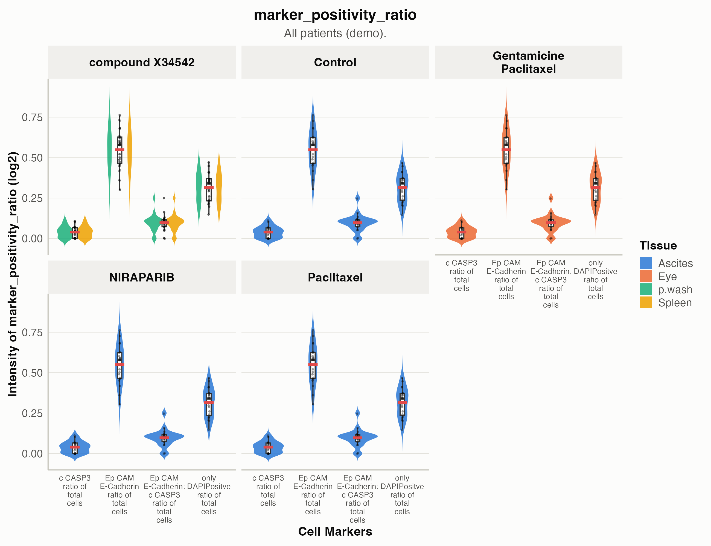
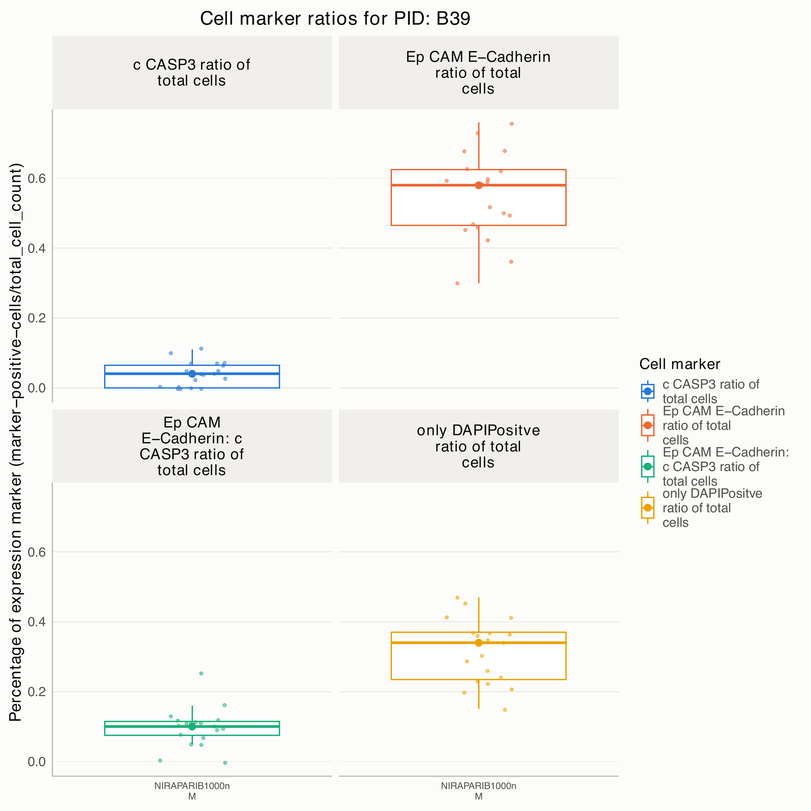
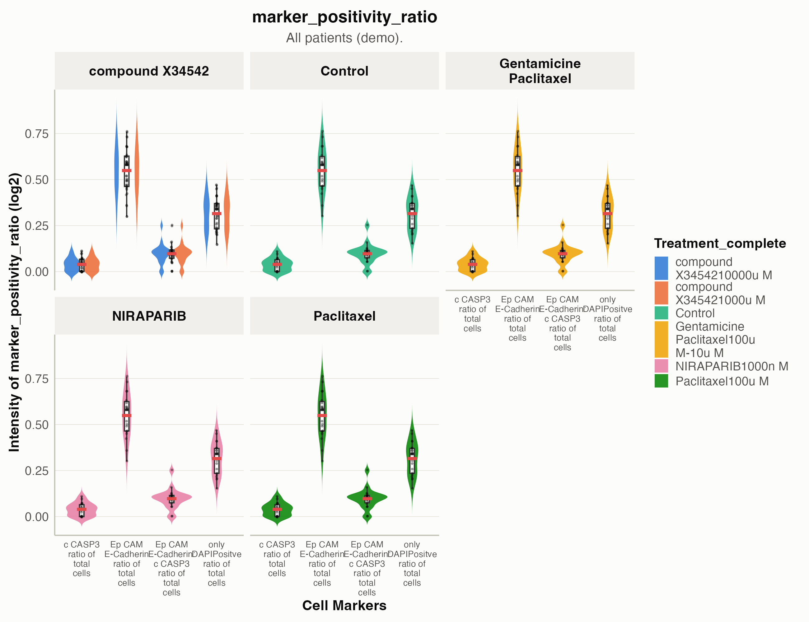
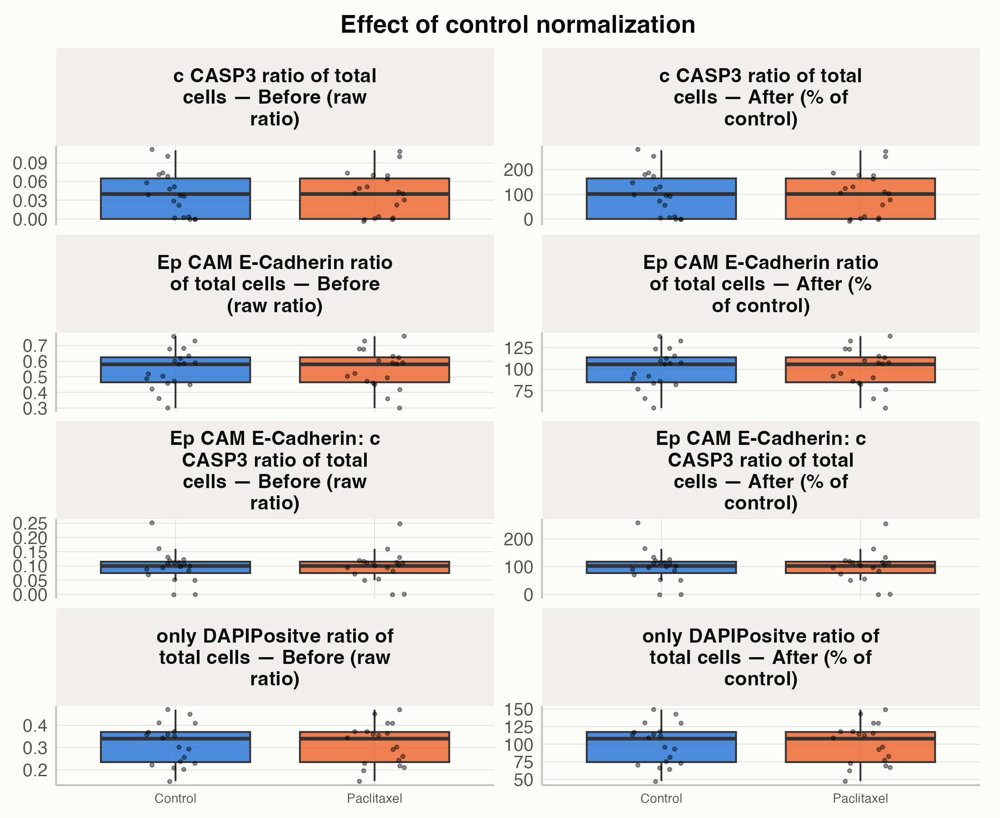

[](https://doi.org/10.5281/zenodo.14747762)


# Overview

drugsens is a R-package that allows users to automatically analyze QuPath&trade;'s output data from imaging analysis. 
Here we include a QuPath&trade; script (the same that we regularly use) to run reproducible QuPath&trade;-based image analysis, and some examples on how drugsens can be used. For more detailed examples of QuPath&trade; scripting and usage please refer to [QuPath&trade;'s Documentation](https://qupath.readthedocs.io/en/stable/). 
This script should be placed into scripts manager within QuPath&trade;. We tested this code with previous versions of QuPath&trade;, but new versions should also be compatible.
This package is complementary to the STAR protocol: [*Protocol for quantifying drug sensitivity in 3D patient-derived ovarian cancer models DOI: 10.1016/j.xpro.2024.103274*](https://doi.org/10.1016/j.xpro.2024.103274).

## Documentation & Vignettes

Full documentation, function references, and step-by-step tutorials are available on the [drugsens documentation site](https://flalom.github.io/drugsens/):

- [Get Started with drugsens](https://flalom.github.io/drugsens/articles/drugsens.html)
- [1. QuPath Setup & Filename Metadata Conventions](https://flalom.github.io/drugsens/articles/qupath-and-metadata.html)
- [2. End-to-End Quality Control & Feature Inspection](https://flalom.github.io/drugsens/articles/quality-control-workflow.html)
- [3. Cohort Normalization, Dose-Response Curves & Statistics](https://flalom.github.io/drugsens/articles/cohort-and-dose-response.html)

# Installation

``` r
# Install from CRAN
install.packages("drugsens")

# Or install the latest development version from GitHub:
devtools::install_github("flalom/drugsens")
```

To install the development version from GitHub (optional), `devtools` is used; if not installed yet, you can install it with:

``` r
# Install devtools from CRAN
install.packages("devtools")

# Or the development version from GitHub:
# install.packages("pak")
pak::pak("r-lib/devtools")
```

You can have a look at [devtools](https://github.com/r-lib/devtools).

### QuPath scripts

__1. Cell Detection & Object Classification Script (STAR Protocol)__

To add and run this script in the latest versions of **QuPath (v0.4 / v0.5+)**:

1. Open your QuPath project and go to the top menu bar: **`Automate` $\rightarrow$ `Show script editor`** (or press `Ctrl + [` on Windows/Linux, `Cmd + [` on macOS).
2. In the Script Editor window, click **`File` $\rightarrow$ `New`** and paste the Groovy script below (tip: you can also save it inside your QuPath project's `scripts/` folder via **`File` $\rightarrow$ `Save As...`** so it is always accessible under **`Automate` $\rightarrow$ `Project scripts`**).
3. Update `<USER_DEFINED_PATH>` and the `<...>` metadata placeholders, and confirm that the channel names (`DAPI`, `E-Cadherin`, `Cleaved Caspase 3`) and single-measurement classifiers match your project.
4. To test on the currently open image, click **`Run` $\rightarrow$ `Run`** (`Ctrl + R` / `Cmd + R`). To process the entire project in batch, select **`Run` $\rightarrow$ `Run for project`** in the Script Editor menu bar, move your images to the **Selected** column, and click **OK**.

``` groovy

/**
 * This QuPath script will take a full image as an annotation
 *
 * 1. Change path to export data, line 41
 * 2. Make sure that the channel order is DAPI, E-Cadherin, and Cleaved Caspase 3
 *      a) if this is not the case, change line 38 (setChannelNames) accordingly
 * 3. Your QuPath project must contain classifiers called "Cleaved Caspase 3" and "E-Cadherin"
 *    If you do not have them, you can download them from our repository,
 *    or create them yourself:
 *      i) In a image, create a selection of the full image (run lines 52-59)
 *      ii) Detect cells (run line 61)
 *      iii) In the Annotation tab, create new classification classes (Add class) called "Cleaved Caspase 3" and "E-Cadherin"
 *      iv) Create classifiers (from the menu Classify > Object Classification > Create single measurement classifier)
 *      v) Name the new classifier "Cleaved Caspase 3", and use following parameters
 *              Object filter = Detections (all)
 *              Channel filter = Cleaved Caspase 3
 *              Measurement = Nucleus: Cleaved Caspase 3 mean
 *              Threshold = 200 (value may differ for your image)
 *              Above threshold = Cleaved Caspase 3
 *      vi) Name the new classifier "E-Cadherin", and use following parameters
 *              Object filter = Detections (all)
 *              Channel filter = E-Cadherin
 *              Measurement = Nucleus: E-Cadherin mean
 *              Threshold = 180 (value may differ for your image)
 *              Above threshold = E-Cadherin
 * 4. Select Run -> Run for project
 *    It will go through all images in the project, run segmentation
 *    & apply those 2 classifiers we set up before.
 *
 * Note:
 *    You are encouraged to check and adjust the classifier before you run them on your own images.
 *    For this, follow steps 3.i) - 3.vi)
 */

import static qupath.lib.gui.scripting.QPEx.*

// Define the path for data export
def path = '<USER_DEFINED_PATH>'

setImageType('FLUORESCENCE');
setChannelNames ('DAPI', 'E-Cadherin', 'Cleaved Caspase 3')

def name = getProjectEntry().getImageName() + '.txt'
path = buildFilePath(path, '<PID>_<TISSUE>_<YYYY-MM-DD>_<SAMPLE_DOC>_<TREATMENT_INITIALS>_<CONCENTRATION>_<CONCENTRATION_UNITS>_<REPLICA_OR_NOT>_<TUMOR_MARKER>_<APOPTOTIC_MARKER>')
mkdirs(path)
path = buildFilePath(path, name)

// Create a new rectangle annotation & add it to the hierarchy
import qupath.lib.roi.RectangleROI
import qupath.lib.objects.PathAnnotationObject
def x_dim = getCurrentImageData().getServer().getWidth()
def y_dim = getCurrentImageData().getServer().getHeight()
def roi = new RectangleROI(0, 0, x_dim, y_dim)
def annotation = new PathAnnotationObject(roi)
addObject(annotation)
setSelectedObject(annotation)

runPlugin('qupath.imagej.detect.cells.WatershedCellDetection', '{"detectionImage": "DAPI",  "requestedPixelSizeMicrons": 0.5,  "backgroundRadiusMicrons": 8.0,  "medianRadiusMicrons": 0.0,  "sigmaMicrons": 2,  "minAreaMicrons": 5.0,  "maxAreaMicrons": 500.0,  "threshold": 45.0,  "watershedPostProcess": true,  "cellExpansionMicrons": 7.5,  "includeNuclei": true,  "smoothBoundaries": true,  "makeMeasurements": true}')
runObjectClassifier("Cleaved Caspase 3", "E-Cadherin")

saveAnnotationMeasurements(path)
print 'Results exported to ' + path
```

__2. Measurement Export Script (Exporting to `.csv`)__

Once cell detection and classification have finished across your project, use this second script to export the single-cell measurements into the `.csv` format expected by `drugsens`:

1. In QuPath, go to **`Automate` $\rightarrow$ `Show script editor`**, then click **`File` $\rightarrow$ `New`** and paste the script below (or click **`File` $\rightarrow$ `Open...`** to load the `script_for_qupath.txt` file generated in R by `generate_qupath_script()`).
2. Set `outputPath` to your desired destination path and filename following the `<PID>_<TISSUE>_...` naming convention, and verify `columnsToInclude` (make sure `"Image"` and `"Name"` are always included).
3. In the Script Editor menu bar, click **`Run` $\rightarrow$ `Run`** (`Ctrl + R` / `Cmd + R`).

   > **Note:** Click **`Run` $\rightarrow$ `Run`** (not `Run for project`), because `MeasurementExporter` automatically iterates through all images in `getProject().getImageList()` and exports them in one step.

``` groovy

/**
 * QuPath script to export measurements from all analysed images in a project
 *
 * 1. Define columns you would like to export (line 28)
 * 2. In line 17, specify the path where to save your results
 */

import qupath.lib.gui.tools.MeasurementExporter
import qupath.lib.objects.PathCellObject
import qupath.lib.objects.PathDetectionObject
import qupath.lib.objects.PathAnnotationObject
import qupath.lib.objects.PathRootObject

// Choose your *full* output path
def outputPath = "<USER_DEFINED_PATH>/<PID>_<TISSUE>_<YYYY-MM-DD>_<SAMPLE_DOC>_<TREATMENT_INITIALS>_<CONCENTRATION>_<CONCENTRATION_UNITS>_<REPLICA_OR_NOT>_<TUMOR_MARKER>_<APOPTOTIC_MARKER>.csv"

// Get the list of all images in the current project
def project = getProject()
def imagesToExport = project.getImageList()

// Separate each measurement value in the output file with ","
def separator = ","

// Choose the columns that will be included in the export
// Note: if 'columnsToInclude' is empty, all columns will be included
def columnsToInclude = new String[]{"Image", "Name", "Class","Centroid X um","Centroid Y um","Nucleus: Area", "Nucleus: DAPI mean","Nucleus: E-Cadherin mean", "Nucleus: Cleaved caspase 3 mean", "Cell: Area","Cell: E-Cadherin mean", "Cell: Cleaved caspase 3 mean","Cytoplasm: E-Cadherin mean","Cytoplasm: Cleaved caspase 3 mean","Nucleus/Cell area ratio"}

// Choose the type of objects that the export will process
// Other possibilities include:
//    1. PathAnnotationObject
//    2. PathDetectionObject
//    3. PathRootObject
// Note: import statements should then be modified accordingly
def exportType = PathCellObject.class

def outputFile = new File(outputPath)

// Create the measurementExporter and start the export
def exporter  = new MeasurementExporter()
        .imageList(imagesToExport)            // Images from which measurements will be exported
        .separator(separator)                 // Character that separates values
        .includeOnlyColumns(columnsToInclude) // Columns are case-sensitive
        .exportType(exportType)               // Type of objects to export
        .exportMeasurements(outputFile)        // Start the export process

print "Done!"
```


# Usage

## Example

We recommend making a new project when working with `drugsens`, to have clear and defined path. This will make the data analysis much easier and reproducible. 
You can also set you working directory with `setwd()`.

### QuPath data in R

To generate the QuPath export script (`script_for_qupath.txt`) in `tempdir()` (or pass `output_dir = "."` to save it in your working directory):

``` r
library("drugsens")
generate_qupath_script()
```

This function will generate a `script_for_qupath.txt` file with the code that one can copy/paste into the __QuPath's script manager__. All the sections that contain \<\> should be replaced with the user experimental information. The `columnsToInclude` in the script should also be user defined, depending on the markers used. 

It is very important that the file naming structure of the QuPath's output is maintained for `drugsens` to work correctly.

> **Note:** The `Image` column must be present in the exported CSV for `drugsens` to parse experimental metadata. For two-drug combinations, follow the `CamelCase` convention described under [Bind QuPath files](#bind-qupath-files).

### Generate configuration file
This command will generate a `config_drugsens.txt` file in `tempdir()` (or in a custom project folder when `forcePath` is supplied) that can be edited to map raw QuPath marker names to clean names.
In our case we replaced `"PathCellObject"` with `"onlyDAPIPositve"`.

``` r
make_run_config()
```
Once `config_drugsens.txt` has been modified, `data_binding()` loads it automatically into the package configuration environment (pass `forcePath` if you stored `config_drugsens.txt` in a project directory). `list_of_relabeling` is a named list used to standardize raw QuPath marker names without polluting `.GlobalEnv`. 
In case the markers naming doesn't need corrections/relabeling you can leave the default configuration unchanged.

> **Note:** We recommend concise, space-free `camelCase` names for cell markers in `list_of_relabeling`:
>
> - Start the marker name with a lowercase letter (for example, `onlyDAPIPositive` or `cCASP3`).
> - Avoid spaces or underscores between words.
> - Capitalize the first letter of each subsequent word.


### Explore example datasets

We present here a few mock datasets, as example workflow. Those files can be explored from the user's R package path:
``` r
system.file("extdata/to_merge/", package = "drugsens")
```

### Bind QuPath files
At first the data is a bunch of separate files which are difficult to make sense of; therefore as first step let's bind them together into a single R dataframe!
The example data can be bound together with this command:
``` r
bind_data <- data_binding(path_to_the_projects_folder = system.file("extdata/to_merge/", package = "drugsens"), files_extension_to_look_for = "csv")
```
You will be now able to `View(bind_data)`. You should see all the image stacks from the QuPath in one dataframe. This dataframe will have all the metadata parsed from the `Image` column value for every stack (image x) (this is the first column defined in the in `columnsToInclude` within the `script_for_qupath.txt`). 
In this code snippets we show an example of mock data `unique(bind_data$PID)` with PIDs: `"A8759" "B36"   "B37", "B38", "B39"` and tissue `"Spleen", "p.wash", "Ascites", "Eye"`. You will have all the metadata in one go and also for drug combinations!

> **Warning:** Keep filenames aligned with the underscore-delimited template above:
>
> - **Dates:** Use `YYYY-MM-DD` (or `YYYY.MM.DD`), and prefix the sample collection date with `DOC` (e.g., `DOC2023-10-05`).
> - **Two-drug combinations:** Concatenate both drug names in `CamelCase` with one capital letter per drug (e.g., `CarboplatinPaclitaxel_100_uM_10_nM`), where the first `<CONC>_<UNIT>` (`100_uM`) belongs to the first drug and the second (`10_nM`) belongs to the second drug.
> - **Missing fields:** Use `.` separated by `_` if a metadata token is unavailable, or open an issue on [GitHub Issues](https://github.com/flalom/drugsens/issues) if you need custom filename rules.

### Counting the number of positiive cells for each marker in every image
This function will take the previous step's generated dataframe and it will counts image by image (sum the markers of every stack) for every sample the number of marker occurrences. 
``` r
counts_dataframe <- make_count_dataframe(bind_data)
```

### Plotting
This function will take the previous step's generated dataframe (`bind_data`) and it will generate some plots for every cell marker and for some key features from the QuPath metadata, such as nucleus area of cell and the mean of marker intensity. The script will generate separate folders for each PID in the dataset. There might be quite some plots, therefore you can isolate specific PID or specific treatment, if that is required. With `fill_color_variable` different variables present in the metadata can be tested to visualize the data.
``` r
get_QC_plots_parsed_merged_data(bind_data, 
                                fill_color_variable = "Tissue", 
                                save_plots = TRUE)
# OR
get_QC_plots_parsed_merged_data(bind_data, 
                                fill_color_variable = "Treatment_complete", 
                                save_plots = TRUE)
```

<br>

### Making plotting-ready data
This function will change the wider format into longer format keeping all the metadata
``` r
plotting_ready_dataframe <- change_data_format_to_longer(counts_dataframe)
```
### Make a plot
Visualizing the results of the previous steps is essential to asses your experiment.
``` r
get_QC_plots(plotting_ready_dataframe, save_plots = TRUE, isolate_a_specific_patient = "B39")
```

<br>

## Run with user's data

Let's run `drugsens` with your data. `drugsens` is not very strict about the capitalization of the file name but is very strict on the position of the parameters. This to avoid potential parsing problems. Here how the labeled data should look like in your QuPath generated file. Here below is shown a the first row from the file `A8759_drug1..conc2.csv` contained as example in `system.file("extdata/to_merge/", package = "drugsens")`

```         
A8759_p.wash_2020.11.10_DOC2001.10.05_compoundX34542_10000_uM_EpCAM_Ecad_cCasp3_(series 01).tif
```

That follows the structure suggested in the QuPath script

```         
"<USER_DEFINED_PATH>/<PID>_<TISSUE>_<YYYY-MM-DD>_<SAMPLE_DOC>_<TREATMENT_INITIALS>_<CONCENTRATION>_<CONCENTRATION_UNITS>_<REPLICA_OR_NOT>_<TUMOR_MARKER>_<APOPTOTIC_MARKER>.csv"
```
> **Warning:** Follow the field order above so `string_parsing()` assigns every token to the right column (`YYYY-MM-DD` dates, `CamelCase` for two-drug combinations such as `CarboplatinPaclitaxel_100_uM_10_nM`, and `.` as a placeholder for missing tokens). See the [QuPath & Metadata tutorial](https://flalom.github.io/drugsens/articles/qupath-and-metadata.html) for worked examples.

### Data Binding and Processing

These lines sets stage for `drugsens` to find the directory path where the microscopy image data are located. `defined_path` is a predefined variable that should contain the base path. This makes it easier to access and manage the files during processing. It is convenient also to define the `desired_file_extensions_of_the_files`, usually `csv` is a good start.

``` r
defined_path <- "<USER_DEFINED_PATH>"
desired_file_extensions <- "csv"
```

You can then

``` r
bind_data <- data_binding(path_to_the_projects_folder = defined_path, 
files_extension_to_look_for = desired_file_extensions, recursive_search = FALSE)
```

> **Note:** Set `recursive_search = FALSE` in `data_binding()` if your target directory contains subfolders from other projects or staining panels.

Each file is read, and additional metadata is extracted. This will return a dataframe of all the csv files within the folder merged with some additional parsing, the metadata is parsed from the file name will be retrieved and appended to the data. Metadata such as:

- **PID** = A unique identifier assigned to each sample. This ID helps in distinguishing and tracking individual samples' data throughout the experiment.
- **Date1** = The date on which the experiment or analysis was conducted. This field records when the data was generated or processed.
- `DOC` = The date when the biological sample was collected.
- `Tissue` = Indicates the type of tissue from which the sample was derived. This could be a specific organ or cell type
- `Image_number` = Represents the order or sequence number of the image in a stack of images
- `Treatment` = The name or type of drug treatment applied to the sample
- `Concentration` = The amount of the drug treatment applied (concentration), quantitatively described.
- `ConcentrationUnits` = The units in which the drug concentration is measured, such as micromolar (uM) or nanomolar (nM)
- `ReplicaOrNot` = Indicates whether the sample is a replica or repeat of a previous experiment
- `Name` = The standardized name of the cell markers as defined in the `config_drugsens.txt` file. This ensures consistency and accuracy in identifying and referring to specific cell markers. 


### A first QC plot
``` r
plots <- get_QC_plots_parsed_merged_data(bind_data, 
fill_color_variable = "Treatment_complete", save_plots = TRUE)
``` 

<br>
This plot shows the ratio of expressed markers across the various conditions; other variables (for example `Tissue` or `Treatment_complete`) can also be used. When `save_plots = TRUE` and `saving_plots_folder = NULL`, files are saved in `file.path(tempdir(), "drugsens_plots")` with subfolders for each PID present in the dataset.

- `.data`: The main dataset, expected to be a dataframe that has been preprocessed and formatted into a long format.
- `list_of_columns_to_plot`: Specifies which columns in the data should be visualized. Defaults to all numeric columns if not provided.
- `save_plots`: A boolean flag indicating whether the plots should be saved as files.
- `saving_plots_folder`: The directory where plot files will be saved, defaulting to `file.path(tempdir(), "drugsens_plots")` when `NULL`.
- `fill_color_variable`: Specifies a variable in the data to use for color-coding the plots, enhancing the visual distinction between different data groups.
- `PID_column_name`, isolate_specific_drug, isolate_specific_patient: Parameters allowing for the isolation of data based on patient ID or specific treatment, facilitating targeted analysis.
- `drug_column_name`: Defines the column that indicates the treatment or drug, with "Treatment" as the default.
- `save_list_of_plots`, `save_plots_in_patient_specific_subfolders`: Flags controlling the saving behavior of the plots, including the option to save in patient-specific subfolders for organized file management.
- `p_height`, `p_width`: Parameters to customize the height and width of the generated plots, ensuring they fit the desired visualization scale.
    
### Cell markers counting

`make_count_dataframe()`, is designed for processing microscopy data stored in a dataframe. It counts occurrences of different markers present in the dataset and computes additional metadata based on unique identifiers within each row.

``` r
cell_markers_counts_data <- make_count_dataframe(bind_data)
```
- `.data`: The input dataframe containing microscopy data.
- `unique_name_row_identifier`: The name of the column in .data that contains unique identifiers for each row (default is "filter_image").
- `name_of_the_markers_column`: The name of the column in .data that contains the names of the markers (default is "Name").

> **Note:** `make_count_dataframe()` accepts `bind_data` directly with default settings. If you renamed the image identifier or marker column, pass your custom column names via `unique_name_row_identifier` and `name_of_the_markers_column`.

The data output will be a dataframe, with all the metadata coming from the previous preprocessing. At this point, you can you the data already, but you can additionally change the format from wider to longer. This is useful especially for plotting and more fine analysis.

### Prepare the data for plotting

`change_data_format_to_longer`, transforms count data from a wide format to a longer format, making it more suitable for certain types of analysis or visualization.
- `.data`: The input dataframe containing count data in a wide format, typically generated from microscopy data processing.
- `pattern_column_markers`: A pattern used to identify columns related to marker ratios (defaults to "_ratio_of_total_cells").
- `unique_name_row_identifier`: The name of the column in .data that contains unique identifiers for each image (defaults to "filter_image").
- `additional_columns`: A logical value indicating whether to include additional metadata columns in the longer format dataframe. It defaults to TRUE.
    
``` r
plotting_format <- change_data_format_to_longer(cell_markers_counts_data)
```


> **Note:** `change_data_format_to_longer()` accepts `cell_markers_counts_data` directly. If you customized the marker ratio suffix or image identifier column, specify `pattern_column_markers`, `unique_name_row_identifier`, or `additional_columns`.

This will return a dataframe that can be easily used for plotting and additional analyses.

### QC plotting

get_QC_plots, is designed for generating Quality Control (QC) plots from preprocessed microscopy data. It visualizes cell marker ratios across different treatments for each patient or a specific patient, aiding in the immediate assessment of data quality and trends.
Input Parameters:

``` r
get_QC_plots(plotting_format, isolate_a_specific_patient = "A8759", save_plots = T)
```
More parameters can be specified to personalize the plot(s).

- `.data`: The preprocessed and merged dataframe, expected to be in a long format, typically obtained after processing through make_count_dataframe() and change_data_format_to_longer().
- `patient_column_name`: Specifies the column in .data that contains patient identifiers (defaults to "PID").
- `colors`: A vector of colors for the plots. Defaults to `unname(drugsens_palette)` (an 8-color CVD-safe palette).
- `save_plots`: A Boolean flag indicating whether to save the generated plots. If TRUE, plots are saved in the specified directory.
- `folder_name`: The directory where plots will be saved if `save_plots = TRUE`. Defaults to `file.path(tempdir(), "figures")` when `NULL`.
- `isolate_a_specific_patient`: If specified, QC plots will be generated for this patient only. Defaults to NULL, meaning plots will be generated for all patients.
- `x_plot_var`: The variable to be used on the x-axis, typically indicating different treatments. Defaults to "Treatment_complete".

### Normalize to control and compare before/after

Once you have plotting-ready data, `normalize_to_control()` expresses every marker value as a percentage of the mean control (vehicle/untreated) value, per patient. This is the standard first step before building dose response curves.

``` r
normalized <- normalize_to_control(plotting_format)
```

- `control_treatment_name`: The value in `treatment_column_name` that identifies control/vehicle wells. Defaults to "Control".
- `group_by_columns`: Columns that define a comparable batch; the control mean is computed within each combination of these columns. Defaults to "PID".

`plot_normalization_before_after()` then shows the raw ratio next to the normalized percent-of-control value, one pair of panels per marker, so you can see at a glance what normalization did to the data:

``` r
plot_normalization_before_after(normalized)
```


<br>

From there, `plot_dose_response()`, `plot_dose_response_heatmap()`, `plot_treatment_summary()`, and `plot_patient_heatmap()` all build on the normalized data to give dose-response curves, treatment x concentration and patient x treatment overviews, and a ranked summary of the whole drug panel. See the [function reference](https://flalom.github.io/drugsens/reference/) for details on each.

## Contributing

We welcome contributions from the community! Here are some ways you can contribute:

- Reporting bugs
- Suggesting enhancements
- Submitting pull requests for bug fixes or new features

### Setting Up the Development Environment

To get started with development, follow these setup instructions:

<details>
<summary>Development Environment Setup</summary>

This project uses `renv` for R package management to ensure reproducibility. To set up your development environment:

1. Clone the repository to your local machine.
2. Open the project in RStudio or start an R session in the project directory.
3. Run `renv::restore()` to install the required R packages.

Renv will automatically activate and install the necessary packages as specified in the `renv.lock` file.

</details>

### Reporting Issues
If you encounter any bugs or have suggestions for improvements, please file an issue on **GitHub Issues:** https://github.com/flalom/drugsens/issues. Be sure to include as much information as possible to help us understand and address the issue.
**BugReports:** https://github.com/flalom/drugsens/issues
