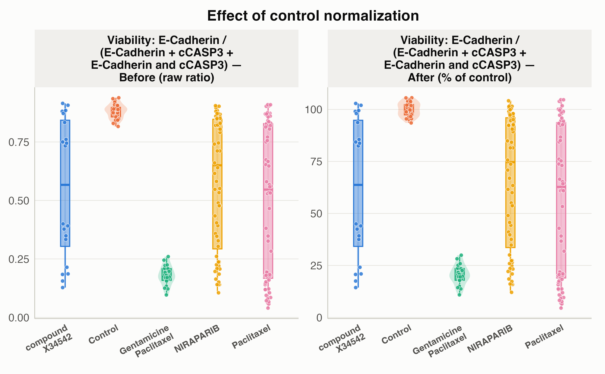
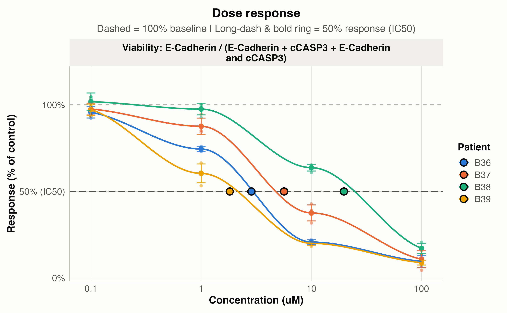
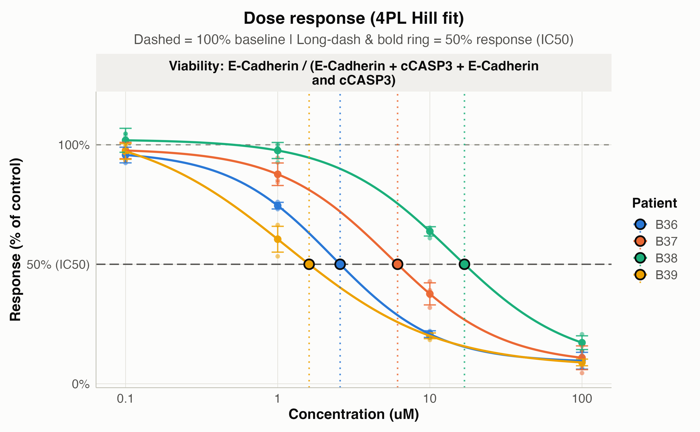
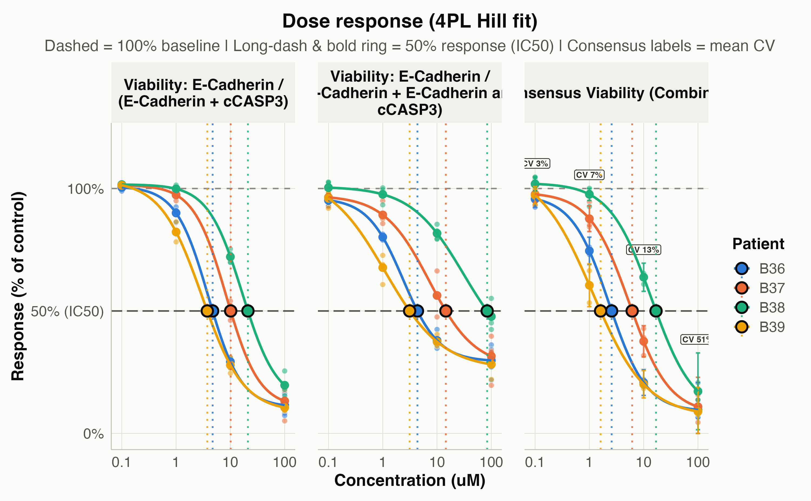
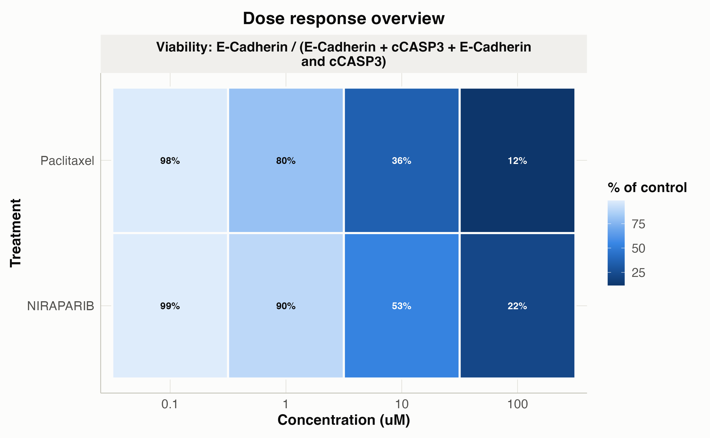
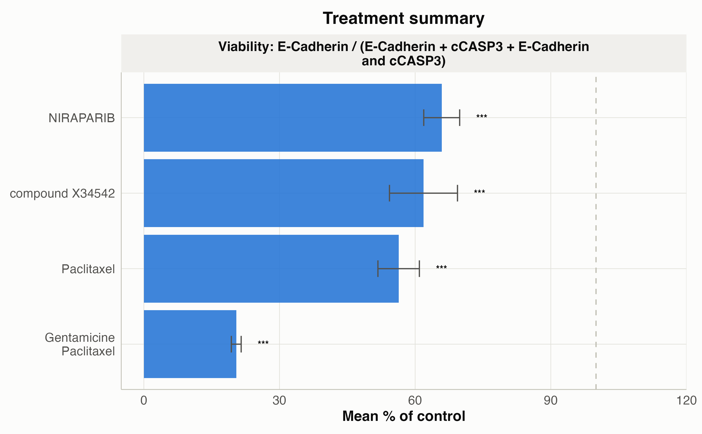
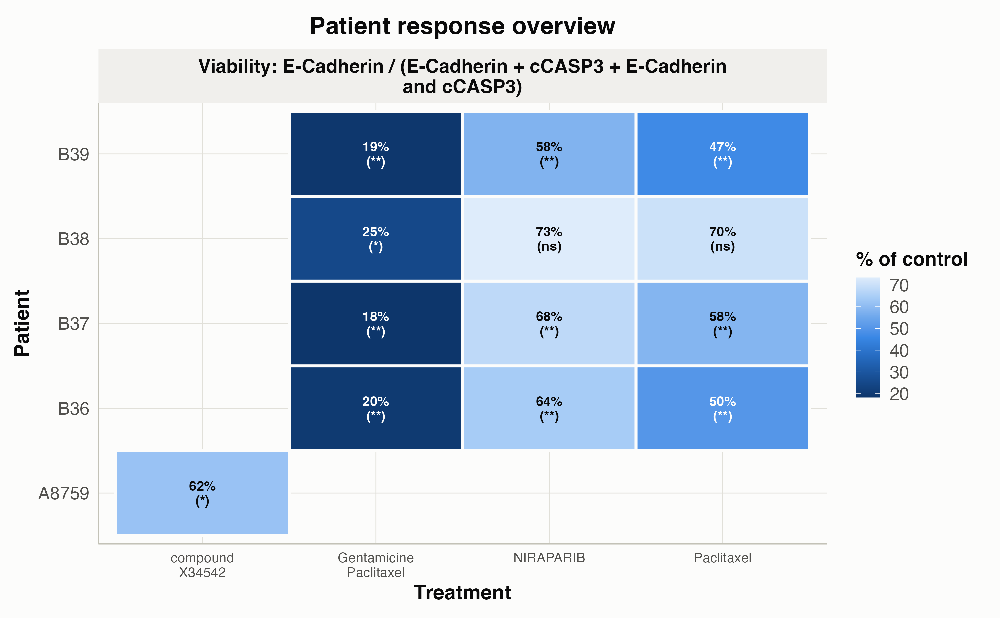
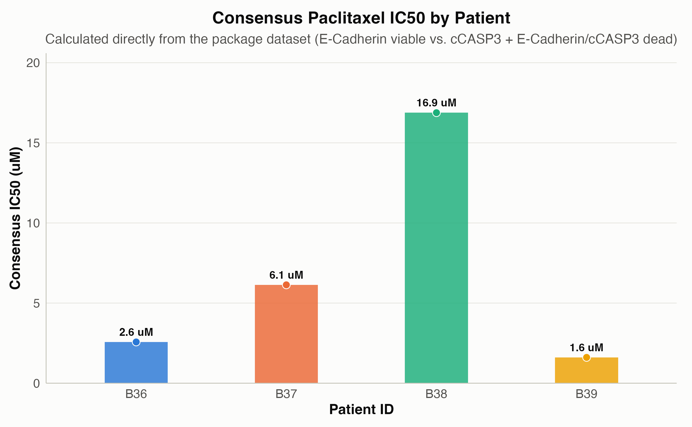

# Cohort Normalization, Dose-Response Curves, and Statistical Comparisons

## Overview

In 3D patient-derived cancer models stained for nuclear, tumor, and
apoptotic markers (**Labrosse et al., 2024**,
[doi:10.1016/j.xpro.2024.103274](https://doi.org/10.1016/j.xpro.2024.103274)),
each image contains:

- **Viable target/cancer cells** (e.g., `E-Cadherin` positive), which
  **decrease** as drug concentration increases.
- **Dying/apoptotic cells** (e.g., `cCASP3` positive and double-positive
  `E-Cadherin and cCASP3`), which **increase** as drug concentration
  increases.
- **Other non-target cells** (e.g., `onlyDAPIPositve` stromal/immune
  cells), which are excluded from the cancer-specific denominator.

To quantify on-target drug sensitivity and estimate IC50, `drugsens`
lets you specify your own **dead/dying cell marker(s)** (`dead_markers`)
and **viable/total target cell marker(s)** (`viable_markers` or
`total_markers`), along with your **control condition**
(`control_treatment_name`):

`Target Cell Viability = 1 - (Dead Cells / Total Target Cells) = Viable Target Cells / (Viable Target Cells + Dead Cells)`

[`normalize_to_control()`](https://flalom.github.io/drugsens/reference/normalize_to_control.md)
then expresses each well’s target cell viability as a percentage of the
matched patient `Control` mean (`pct_of_control`, where
`Control = 100%`), enabling:

1.  Side-by-side inspection before and after control normalization
    ([`plot_normalization_before_after()`](https://flalom.github.io/drugsens/reference/plot_normalization_before_after.md)).
2.  Dose-response curve fitting via LOESS or 4-parameter log-logistic
    (`4pl`) Hill models with single-marker or multi-marker consensus
    IC50 estimation
    ([`plot_dose_response()`](https://flalom.github.io/drugsens/reference/plot_dose_response.md)).
3.  Multi-drug and multi-patient cohort summaries
    ([`plot_dose_response_heatmap()`](https://flalom.github.io/drugsens/reference/plot_dose_response_heatmap.md),
    [`plot_treatment_summary()`](https://flalom.github.io/drugsens/reference/plot_treatment_summary.md),
    [`plot_patient_heatmap()`](https://flalom.github.io/drugsens/reference/plot_patient_heatmap.md)).

------------------------------------------------------------------------

## 1. Loading the Package Dataset (`extdata/to_merge`)

We load the single-cell QuPath exports shipped with `drugsens` in
`extdata/to_merge/`, compute per-image marker counts and ratios
([`make_count_dataframe()`](https://flalom.github.io/drugsens/reference/make_count_dataframe.md)),
and pivot to long format
([`change_data_format_to_longer()`](https://flalom.github.io/drugsens/reference/change_data_format_to_longer.md)):

\
[`library`](https://rdrr.io/r/base/library.html)`(`[`drugsens`](https://flalom.github.io/drugsens/)`)`\
[`library`](https://rdrr.io/r/base/library.html)`(`[`ggplot2`](https://ggplot2.tidyverse.org)`)`\
\
`example_dir`` ``<-`` `[`system.file`](https://rdrr.io/r/base/system.file.html)`(``"extdata/to_merge/"``, package ``=`` ``"drugsens"``)`\
`bind_data`` ``<-`` `[`data_binding`](https://flalom.github.io/drugsens/reference/data_binding.md)`(`\
`  path_to_the_projects_folder ``=`` ``example_dir``,`\
`  files_extension_to_look_for ``=`` ``"csv"`\
`)`\
\
`counts_df`` ``<-`` `[`make_count_dataframe`](https://flalom.github.io/drugsens/reference/make_count_dataframe.md)`(``bind_data``)`\
`long_df`` ``<-`` `[`change_data_format_to_longer`](https://flalom.github.io/drugsens/reference/change_data_format_to_longer.md)`(``counts_df``)`\
\
`# Inspect patients, treatments, and marker populations in the dataset`\
[`unique`](https://rdrr.io/r/base/unique.html)`(``long_df``[``, `[`c`](https://rdrr.io/r/base/c.html)`(``"PID"``, ``"Tissue"``, ``"Treatment"``)``]``)`\
`#> ``# A tibble: 19 × 3`\
`#>    PID   Tissue  Treatment            `\
`#>    ``<chr>`` ``<chr>``   ``<chr>``                `\
`#> `` 1`` A8759 p.wash  compoundX34542       `\
`#> `` 2`` A8759 Spleen  Control              `\
`#> `` 3`` A8759 Spleen  compoundX34542       `\
`#> `` 4`` B36   Ascites Control              `\
`#> `` 5`` B36   Ascites Paclitaxel           `\
`#> `` 6`` B36   Ascites NIRAPARIB            `\
`#> `` 7`` B36   Ascites GentamicinePaclitaxel`\
`#> `` 8`` B37   Ascites Control              `\
`#> `` 9`` B37   Ascites Paclitaxel           `\
`#> ``10`` B37   Ascites NIRAPARIB            `\
`#> ``11`` B37   Ascites GentamicinePaclitaxel`\
`#> ``12`` B38   Eye     GentamicinePaclitaxel`\
`#> ``13`` B38   Eye     Control              `\
`#> ``14`` B38   Eye     Paclitaxel           `\
`#> ``15`` B38   Eye     NIRAPARIB            `\
`#> ``16`` B39   Ascites Control              `\
`#> ``17`` B39   Ascites Paclitaxel           `\
`#> ``18`` B39   Ascites NIRAPARIB            `\
`#> ``19`` B39   Ascites GentamicinePaclitaxel`\
[`unique`](https://rdrr.io/r/base/unique.html)`(``long_df``$``marker_positivity``)`\
`#> [1] "onlyDAPIPositve_ratio_of_total_cells"      `\
`#> [2] "E-Cadherin_ratio_of_total_cells"           `\
`#> [3] "cCASP3_ratio_of_total_cells"               `\
`#> [4] "E-Cadherin and cCASP3_ratio_of_total_cells"`

------------------------------------------------------------------------

## 2. Selecting Dead and Target Cells & Normalizing to Control (`normalize_to_control()`)

In
[`normalize_to_control()`](https://flalom.github.io/drugsens/reference/normalize_to_control.md),
you can specify:

- `dead_markers`: marker(s) representing dying/dead cells (e.g.,
  `"cCASP3"` or `c("cCASP3", "E-Cadherin and cCASP3")`),
- `viable_markers` (or `total_markers`): marker(s) representing viable
  cancer cells (here `"E-Cadherin"`, excluding `onlyDAPIPositve`),
- `control_treatment_name`: your vehicle/untreated control label (here
  `"Control"`).

Here we compute combined target cell viability across the cohort
(`consensus_only = TRUE` produces a single combined viability metric per
well when multiple dead markers are supplied):

\
`norm_df`` ``<-`` `[`normalize_to_control`](https://flalom.github.io/drugsens/reference/normalize_to_control.md)`(`\
`  ``long_df``,`\
`  dead_markers ``=`` `[`c`](https://rdrr.io/r/base/c.html)`(``"cCASP3"``, ``"E-Cadherin and cCASP3"``)``,`\
`  viable_markers ``=`` ``"E-Cadherin"``,`\
`  control_treatment_name ``=`` ``"Control"``,`\
`  treatment_column_name ``=`` ``"Treatment"``,`\
`  group_by_columns ``=`` ``"PID"``,`\
`  consensus_only ``=`` ``TRUE`\
`)`\
\
[`head`](https://rdrr.io/r/utils/head.html)`(``norm_df``[``, `[`c`](https://rdrr.io/r/base/c.html)`(``"PID"``, ``"Treatment"``, ``"Concentration1"``, ``"dead_fraction"``, ``"viable_fraction"``, ``"pct_of_control"``)``]``)`\
`#> ``# A tibble: 6 × 6`\
`#>   PID   Treatment    Concentration1 dead_fraction viable_fraction pct_of_control`\
`#>   ``<chr>`` ``<chr>``        ``<chr>``                  ``<dbl>``           ``<dbl>``          ``<dbl>`\
`#> ``1`` A8759 compoundX34… 10                    0.093``1``           0.907          102. `\
`#> ``2`` A8759 compoundX34… 10                    0.119            0.881           99.1`\
`#> ``3`` A8759 compoundX34… 10                    0.128            0.872           98.0`\
`#> ``4`` A8759 compoundX34… 10                    0.115            0.885           99.5`\
`#> ``5`` A8759 compoundX34… 10                    0.085``2``           0.915          103. `\
`#> ``6`` A8759 compoundX34… 10000                 0.872            0.128           14.4`\
\
[`plot_normalization_before_after`](https://flalom.github.io/drugsens/reference/plot_normalization_before_after.md)`(``norm_df``)`

Notice how inter-patient differences in baseline viability (**Before**,
left panel) are aligned to `100%` in the `Control` group (**After**,
right panel).

------------------------------------------------------------------------

## 3. Dose-Response Curves: LOESS, 4PL Hill Models & Consensus IC50 (`plot_dose_response()`)

You can pass `norm_df` (or pass `long_df` directly with `dead_markers`,
`viable_markers`, and `selected_treatments`) to
[`plot_dose_response()`](https://flalom.github.io/drugsens/reference/plot_dose_response.md).

### Non-Parametric LOESS Curve (`method = "loess"`)

\
[`plot_dose_response`](https://flalom.github.io/drugsens/reference/plot_dose_response.md)`(`\
`  ``norm_df``,`\
`  selected_treatments ``=`` ``"Paclitaxel"``,`\
`  method ``=`` ``"loess"`\
`)`

### 4-Parameter Log-Logistic Hill Curve & IC50 (`method = "4pl"`)

Setting `method = "4pl"` fits a 4-parameter log-logistic Hill equation
per patient using
[`stats::optim()`](https://rdrr.io/r/stats/optim.html), overlays the
fitted sigmoidal curves, marks each patient’s estimated IC50
(`show_ic50 = TRUE`), and stores the parameter table in
`attr(plot, "ic50")`:

\
`p_4pl`` ``<-`` `[`plot_dose_response`](https://flalom.github.io/drugsens/reference/plot_dose_response.md)`(`\
`  ``norm_df``,`\
`  selected_treatments ``=`` ``"Paclitaxel"``,`\
`  method ``=`` ``"4pl"``,`\
`  show_ic50 ``=`` ``TRUE`\
`)`\
`p_4pl`

\
\
`# Inspect estimated IC50 and Hill parameters per patient`\
[`attr`](https://rdrr.io/r/base/attr.html)`(``p_4pl``, ``"ic50"``)`\
`#>     bottom       top      ic50      ec50 y_ic50 hill_slope converged`\
`#> 1 8.908520  97.34016  2.572026  2.300467     50  1.2686472      TRUE`\
`#> 2 8.098495  98.39673  6.137040  5.433755     50  1.1840277      TRUE`\
`#> 3 7.931003 102.24226 16.881294 13.924208     50  1.1246431      TRUE`\
`#> 4 6.982642 107.74076  1.608725  1.151282     50  0.8798262      TRUE`\
`#>   ic50_reached PID`\
`#> 1         TRUE B36`\
`#> 2         TRUE B37`\
`#> 3         TRUE B38`\
`#> 4         TRUE B39`\
`#>                                                       marker_positivity`\
`#> 1 Viability: E-Cadherin / (E-Cadherin + cCASP3 + E-Cadherin and cCASP3)`\
`#> 2 Viability: E-Cadherin / (E-Cadherin + cCASP3 + E-Cadherin and cCASP3)`\
`#> 3 Viability: E-Cadherin / (E-Cadherin + cCASP3 + E-Cadherin and cCASP3)`\
`#> 4 Viability: E-Cadherin / (E-Cadherin + cCASP3 + E-Cadherin and cCASP3)`\
`#>   is_consensus`\
`#> 1         TRUE`\
`#> 2         TRUE`\
`#> 3         TRUE`\
`#> 4         TRUE`

### Multi-Marker Selection, Consensus IC50 & Per-Point Coefficient of Variation (`consensus_dispersion`)

In our dataset, QuPath exports two apoptotic/dead cell populations
(`"cCASP3"` late apoptosis and double-positive `"E-Cadherin and cCASP3"`
early/mid apoptosis) alongside viable cancer cells (`"E-Cadherin"`).
When you supply multiple markers to
[`plot_dose_response()`](https://flalom.github.io/drugsens/reference/plot_dose_response.md)
with `consensus_only = FALSE` (the default), `drugsens` automatically
generates:

1.  **Individual panels** for each marker pair
    (`E-Cadherin / (E-Cadherin + cCASP3)` and
    `E-Cadherin / (E-Cadherin + E-Cadherin and cCASP3)`),
2.  A **`Consensus Viability (Combined)`** panel that combines the
    markers, marks the **bold 50% response point (IC50)** on every
    curve, and overlays per-point dispersion
    (`consensus_dispersion = "cv"` for standard Coefficient of
    Variation, or `"rcvq"`, `"rcv_mad"`, `"sd"`, `"se"`, `"iqr"`,
    `"mad"`):

\
`p_multi`` ``<-`` `[`plot_dose_response`](https://flalom.github.io/drugsens/reference/plot_dose_response.md)`(`\
`  ``long_df``,`\
`  viable_markers ``=`` ``"E-Cadherin"``,`\
`  dead_markers ``=`` `[`c`](https://rdrr.io/r/base/c.html)`(``"cCASP3"``, ``"E-Cadherin and cCASP3"``)``,`\
`  control_treatment_name ``=`` ``"Control"``,`\
`  selected_treatments ``=`` ``"Paclitaxel"``,`\
`  method ``=`` ``"4pl"``,`\
`  show_ic50 ``=`` ``TRUE``,`\
`  consensus_dispersion ``=`` ``"cv"``,`\
`  show_cv ``=`` ``TRUE`\
`)`\
`p_multi`

\
\
`# Consensus IC50 from the combined markers:`\
[`attr`](https://rdrr.io/r/base/attr.html)`(``p_multi``, ``"consensus_ic50"``)``[``, `[`c`](https://rdrr.io/r/base/c.html)`(``"PID"``, ``"ic50"``, ``"hill_slope"``, ``"bottom"``, ``"top"``)``]`\
`#>    PID      ic50 hill_slope   bottom       top`\
`#> 3  B36  2.572026  1.2686472 8.908520  97.34016`\
`#> 6  B37  6.137040  1.1840277 8.098495  98.39673`\
`#> 9  B38 16.881294  1.1246431 7.931003 102.24226`\
`#> 12 B39  1.608725  0.8798262 6.982642 107.74076`\
\
`# Per-point CV and dispersion metrics on the Consensus curve:`\
[`head`](https://rdrr.io/r/utils/head.html)`(`[`attr`](https://rdrr.io/r/base/attr.html)`(``p_multi``, ``"consensus_cv"``)``[``, `[`c`](https://rdrr.io/r/base/c.html)`(``"PID"``, ``"Concentration1"``, ``"mean_pct_of_control"``, ``"sd"``, ``"cv"``, ``"rcvq"``, ``"rcv_mad"``)``]``)`\
`#>   PID Concentration1 mean_pct_of_control        sd        cv      rcvq`\
`#> 1 B36            0.1           95.715060  3.406344  3.482272  3.528984`\
`#> 2 B36            1.0           74.533927  5.594794  6.575558  9.235112`\
`#> 3 B36           10.0           20.776844  5.272032 15.680938 16.028484`\
`#> 4 B36          100.0            9.641045 11.097608 53.713315 63.869784`\
`#> 5 B37            0.1           97.607021  3.294000  3.333123  3.408780`\
`#> 6 B37            1.0           87.671931  5.250795  5.627409  7.001187`\
`#>     rcv_mad`\
`#> 1  2.842508`\
`#> 2  7.544353`\
`#> 3 15.328480`\
`#> 4 73.697467`\
`#> 5  2.391068`\
`#> 6  6.067683`

------------------------------------------------------------------------

## 4. Drug Panel & Cohort Overview Plots

### Treatment x Concentration Heatmap (`plot_dose_response_heatmap()`)

Summarize the drug screen across doses (`Paclitaxel` and `NIRAPARIB`),
with `show_values = TRUE` to print mean `% of control` inside each tile
(deepest blue highlights the strongest drug effect / lowest remaining
viability):

\
`norm_panel`` ``<-`` ``norm_df``[``norm_df``$``Treatment`` `[`%in%`](https://rdrr.io/r/base/match.html)` `[`c`](https://rdrr.io/r/base/c.html)`(``"Control"``, ``"Paclitaxel"``, ``"NIRAPARIB"``)``, ``]`\
[`plot_dose_response_heatmap`](https://flalom.github.io/drugsens/reference/plot_dose_response_heatmap.md)`(``norm_panel``, show_values ``=`` ``TRUE``)`

### Ranked Treatment Summary with Statistical Comparisons (`plot_treatment_summary()`)

Rank all treatments in the dataset by overall effect size and test each
treatment against `Control` using Wilcoxon rank-sum
(`stat_method = "wilcox"`) or t-tests (`stat_method = "t.test"`), with
multiple-testing correction (`p_adjust_method = "BH"`, `"bonferroni"`,
`"holm"`, `"none"`, etc.) and full test results stored in
`attr(plot, "stats")`:

> **Statistical Note:** When multiple concentrations or imaged fields of
> view are present for a drug,
> [`plot_treatment_summary()`](https://flalom.github.io/drugsens/reference/plot_treatment_summary.md)
> and
> [`plot_patient_heatmap()`](https://flalom.github.io/drugsens/reference/plot_patient_heatmap.md)
> pool observations across doses for an overall condition comparison
> against `Control`. To test specific concentrations individually
> without pooling across doses, subset `norm_df` to a single
> concentration or use
> `get_QC_plots(..., x_plot_var = "Treatment_complete", compare_to_control = TRUE)`.

\
`p_sum`` ``<-`` `[`plot_treatment_summary`](https://flalom.github.io/drugsens/reference/plot_treatment_summary.md)`(`\
`  ``norm_df``,`\
`  compare_to_control ``=`` ``TRUE``,`\
`  stat_method ``=`` ``"wilcox"``,`\
`  p_adjust_method ``=`` ``"BH"``,`\
`  pvalue_label ``=`` ``"p.adj.signif"`\
`)`\
`p_sum`

\
\
`# Inspect raw p_value and BH-adjusted p_adj per treatment`\
[`attr`](https://rdrr.io/r/base/attr.html)`(``p_sum``, ``"stats"``)``[``, `[`c`](https://rdrr.io/r/base/c.html)`(``"group"``, ``"p_value"``, ``"p_adj"``, ``"p_adjust_method"``, ``"label"``)``]`\
`#>                   group      p_value        p_adj p_adjust_method label`\
`#> 1        compoundX34542 1.690244e-05 1.690244e-05              BH   ***`\
`#> 2            Paclitaxel 2.072099e-09 5.181105e-09              BH   ***`\
`#> 3             NIRAPARIB 2.956067e-09 5.181105e-09              BH   ***`\
`#> 4 GentamicinePaclitaxel 3.885829e-09 5.181105e-09              BH   ***`

### Patient x Treatment Cohort Heatmap (`plot_patient_heatmap()`)

Compare patient-specific drug sensitivity profiles across the cohort
(`B36`, `B37`, `B38`, `B39`, and `A8759`), with
`compare_to_control = TRUE` and `p_adjust_method = "BH"` to annotate
each tile with its BH-adjusted significance against `Control`:

\
[`plot_patient_heatmap`](https://flalom.github.io/drugsens/reference/plot_patient_heatmap.md)`(`\
`  ``norm_df``,`\
`  show_values ``=`` ``TRUE``,`\
`  compare_to_control ``=`` ``TRUE``,`\
`  stat_method ``=`` ``"wilcox"``,`\
`  p_adjust_method ``=`` ``"BH"``,`\
`  pvalue_label ``=`` ``"p.adj.signif"`\
`)`

------------------------------------------------------------------------

## 5. Customizing Plots with `drugsens_theme()` and `drugsens_palette`

Both
[`drugsens_theme()`](https://flalom.github.io/drugsens/reference/drugsens_theme.md)
and the colorblind-safe `drugsens_palette` are exported so you can build
custom visualizations (such as comparing each patient’s consensus IC50)
that match the rest of your `drugsens` report:

\
`ic50_df`` ``<-`` `[`attr`](https://rdrr.io/r/base/attr.html)`(``p_multi``, ``"consensus_ic50"``)`\
\
[`ggplot`](https://ggplot2.tidyverse.org/reference/ggplot.html)`(``ic50_df``, `[`aes`](https://ggplot2.tidyverse.org/reference/aes.html)`(``x ``=`` ``PID``, y ``=`` ``ic50``, fill ``=`` ``PID``, color ``=`` ``PID``)``)`` ``+`\
`  `[`geom_col`](https://ggplot2.tidyverse.org/reference/geom_bar.html)`(``width ``=`` ``0.42``, alpha ``=`` ``0.82``, color ``=`` ``NA``)`` ``+`\
`  `[`geom_point`](https://ggplot2.tidyverse.org/reference/geom_point.html)`(``size ``=`` ``3.4``, shape ``=`` ``21``, color ``=`` ``"#fcfcfb"``, stroke ``=`` ``0.6``)`` ``+`\
`  `[`geom_text`](https://ggplot2.tidyverse.org/reference/geom_text.html)`(`\
`    `[`aes`](https://ggplot2.tidyverse.org/reference/aes.html)`(``label ``=`` `[`sprintf`](https://rdrr.io/r/base/sprintf.html)`(``"%.1f uM"``, ``ic50``)``)``,`\
`    vjust ``=`` ``-``0.8``,`\
`    fontface ``=`` ``"bold"``,`\
`    size ``=`` ``4.0``,`\
`    color ``=`` ``"#0b0b0b"`\
`  ``)`` ``+`\
`  `[`scale_fill_manual`](https://ggplot2.tidyverse.org/reference/scale_manual.html)`(``values ``=`` `[`unname`](https://rdrr.io/r/base/unname.html)`(``drugsens_palette``)``)`` ``+`\
`  `[`scale_color_manual`](https://ggplot2.tidyverse.org/reference/scale_manual.html)`(``values ``=`` `[`unname`](https://rdrr.io/r/base/unname.html)`(``drugsens_palette``)``)`` ``+`\
`  `[`scale_y_continuous`](https://ggplot2.tidyverse.org/reference/scale_continuous.html)`(``expand ``=`` `[`expansion`](https://ggplot2.tidyverse.org/reference/expansion.html)`(``mult ``=`` `[`c`](https://rdrr.io/r/base/c.html)`(``0``, ``0.22``)``)``)`` ``+`\
`  `[`labs`](https://ggplot2.tidyverse.org/reference/labs.html)`(`\
`    title ``=`` ``"Consensus Paclitaxel IC50 by Patient"``,`\
`    subtitle ``=`` ``"Calculated directly from the package dataset (E-Cadherin viable vs. cCASP3 + E-Cadherin/cCASP3 dead)"``,`\
`    x ``=`` ``"Patient ID"``,`\
`    y ``=`` ``"Consensus IC50 (uM)"`\
`  ``)`` ``+`\
`  `[`drugsens_theme`](https://flalom.github.io/drugsens/reference/drugsens_theme.md)`(``)`` ``+`\
`  `[`theme`](https://ggplot2.tidyverse.org/reference/theme.html)`(`\
`    panel.grid.major.x ``=`` `[`element_blank`](https://ggplot2.tidyverse.org/reference/element.html)`(``)``,`\
`    legend.position ``=`` ``"none"`\
`  ``)`

