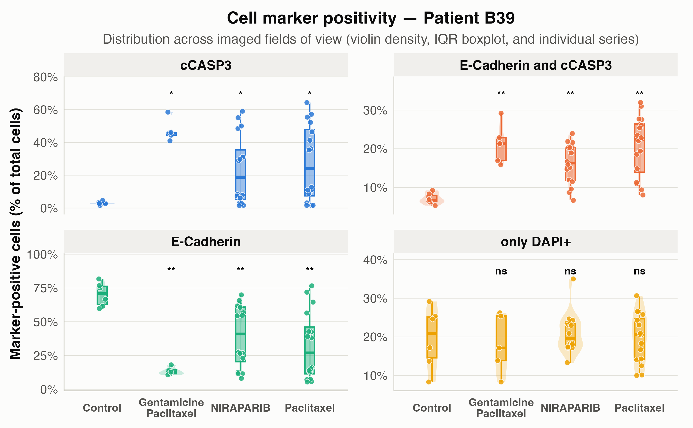
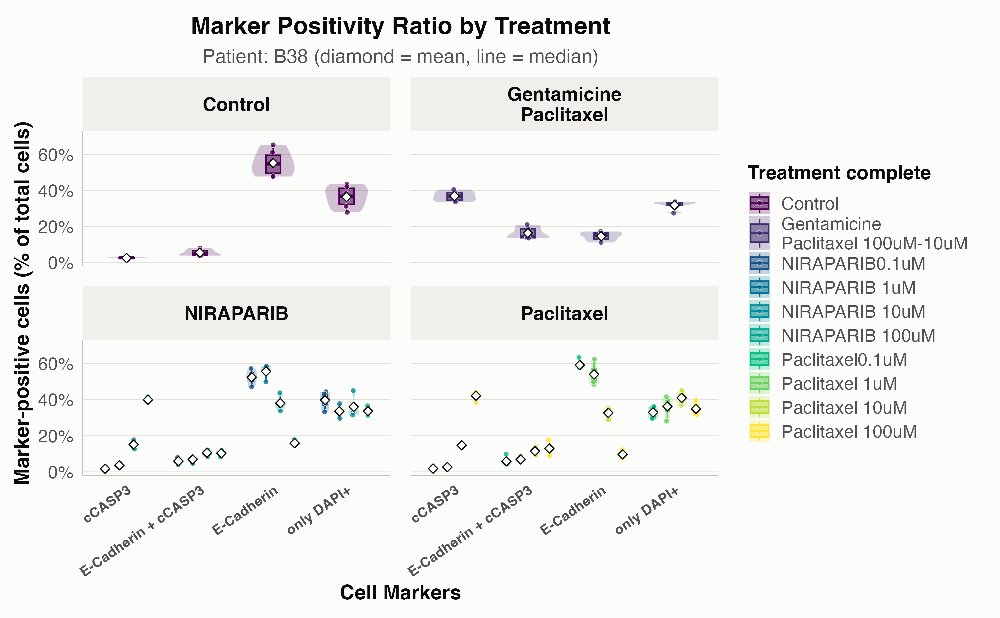
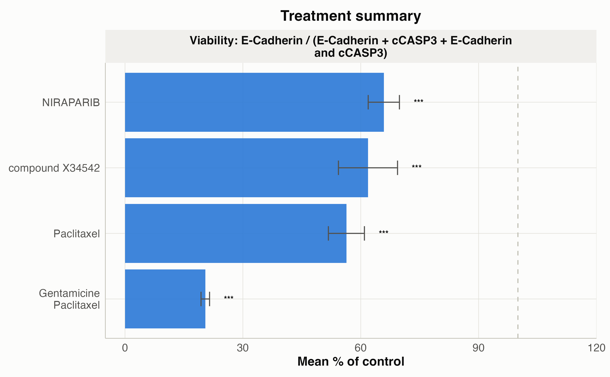

# Get Started with drugsens

## 5-Minute Quickstart

`drugsens` automates the processing, quality control, control
normalization, and dose-response visualization of single-cell
fluorescence microscopy data exported from **QuPath**, following the
protocol in **Labrosse et al. (2024)**
([doi:10.1016/j.xpro.2024.103274](https://doi.org/10.1016/j.xpro.2024.103274)).

### 1. Import and Bind QuPath CSV Exports

\
[`library`](https://rdrr.io/r/base/library.html)`(`[`drugsens`](https://flalom.github.io/drugsens/)`)`\
\
`example_dir`` ``<-`` `[`system.file`](https://rdrr.io/r/base/system.file.html)`(``"extdata/to_merge/"``, package ``=`` ``"drugsens"``)`\
`bind_data`` ``<-`` `[`data_binding`](https://flalom.github.io/drugsens/reference/data_binding.md)`(`\
`  path_to_the_projects_folder ``=`` ``example_dir``,`\
`  files_extension_to_look_for ``=`` ``"csv"`\
`)`\
\
[`head`](https://rdrr.io/r/utils/head.html)`(``bind_data``[``, `[`c`](https://rdrr.io/r/base/c.html)`(``"PID"``, ``"Tissue"``, ``"Treatment"``, ``"Concentration1"``, ``"ConcentrationUnits1"``, ``"Name"``)``]``)`\
`#>     PID Tissue Treatment Concentration1 ConcentrationUnits1            Name`\
`#> 1 A8759 Spleen   Control           <NA>                <NA> onlyDAPIPositve`\
`#> 2 A8759 Spleen   Control           <NA>                <NA> onlyDAPIPositve`\
`#> 3 A8759 Spleen   Control           <NA>                <NA> onlyDAPIPositve`\
`#> 4 A8759 Spleen   Control           <NA>                <NA> onlyDAPIPositve`\
`#> 5 A8759 Spleen   Control           <NA>                <NA> onlyDAPIPositve`\
`#> 6 A8759 Spleen   Control           <NA>                <NA> onlyDAPIPositve`

### 2. Count Marker-Positive Cells and Reshape to Long Format

\
`counts_df`` ``<-`` `[`make_count_dataframe`](https://flalom.github.io/drugsens/reference/make_count_dataframe.md)`(``bind_data``)`\
`long_df`` ``<-`` `[`change_data_format_to_longer`](https://flalom.github.io/drugsens/reference/change_data_format_to_longer.md)`(``counts_df``)`\
\
[`head`](https://rdrr.io/r/utils/head.html)`(``long_df``[``, `[`c`](https://rdrr.io/r/base/c.html)`(``"PID"``, ``"Tissue"``, ``"Treatment_complete"``, ``"marker_positivity"``, ``"marker_positivity_ratio"``)``]``)`\
`#> ``# A tibble: 6 × 5`\
`#>   PID   Tissue Treatment_complete marker_positivity       marker_positivity_ra…¹`\
`#>   ``<chr>`` ``<chr>``  ``<chr>``              ``<chr>``                                    ``<dbl>`\
`#> ``1`` A8759 p.wash compoundX3454210uM onlyDAPIPositve_ratio_…                 0.338 `\
`#> ``2`` A8759 p.wash compoundX3454210uM E-Cadherin_ratio_of_to…                 0.6   `\
`#> ``3`` A8759 p.wash compoundX3454210uM cCASP3_ratio_of_total_…                 0.015``4`\
`#> ``4`` A8759 p.wash compoundX3454210uM E-Cadherin and cCASP3_…                 0.046``2`\
`#> ``5`` A8759 p.wash compoundX3454210uM onlyDAPIPositve_ratio_…                 0.354 `\
`#> ``6`` A8759 p.wash compoundX3454210uM E-Cadherin_ratio_of_to…                 0.569 `\
`#> ``# ℹ abbreviated name: ¹​marker_positivity_ratio`

### 3. Inspect Quality Control (QC) Distributions

Plot per-marker positivity distributions for a single patient
([`get_QC_plots()`](https://flalom.github.io/drugsens/reference/get_QC_plots.md)):

\
[`get_QC_plots`](https://flalom.github.io/drugsens/reference/get_QC_plots.md)`(`\
`  ``long_df``,`\
`  isolate_a_specific_patient ``=`` ``"B39"``,`\
`  x_plot_var ``=`` ``"Treatment"``,`\
`  compare_to_control ``=`` ``TRUE``,`\
`  save_plots ``=`` ``FALSE`\
`)`

Or inspect marker positivity across treatments for a patient
([`get_QC_plots_parsed_merged_data()`](https://flalom.github.io/drugsens/reference/get_QC_plots_parsed_merged_data.md)):

\
`qc_list`` ``<-`` `[`get_QC_plots_parsed_merged_data`](https://flalom.github.io/drugsens/reference/get_QC_plots_parsed_merged_data.md)`(`\
`  ``long_df``,`\
`  list_of_columns_to_plot ``=`` ``"marker_positivity_ratio"``,`\
`  fill_color_variable ``=`` ``"Treatment_complete"``,`\
`  isolate_specific_patient ``=`` ``"B38"``,`\
`  save_plots ``=`` ``FALSE``,`\
`  verbose ``=`` ``FALSE`\
`)`\
\
`qc_list``[[``"B38.marker_positivity_ratio"``]``]`

### 4. Normalize Target Cell Viability to Control & Fit Dose-Response

Select your dead/dying marker(s) (`dead_markers`) and viable cancer
marker(s) (`viable_markers`) in
[`normalize_to_control()`](https://flalom.github.io/drugsens/reference/normalize_to_control.md)
to compute target cancer cell viability relative to `Control` (`100%`):

\
`norm_df`` ``<-`` `[`normalize_to_control`](https://flalom.github.io/drugsens/reference/normalize_to_control.md)`(`\
`  ``long_df``,`\
`  dead_markers ``=`` `[`c`](https://rdrr.io/r/base/c.html)`(``"cCASP3"``, ``"E-Cadherin and cCASP3"``)``,`\
`  viable_markers ``=`` ``"E-Cadherin"``,`\
`  control_treatment_name ``=`` ``"Control"``,`\
`  consensus_only ``=`` ``TRUE`\
`)`\
\
[`plot_treatment_summary`](https://flalom.github.io/drugsens/reference/plot_treatment_summary.md)`(``norm_df``, compare_to_control ``=`` ``TRUE``)`

------------------------------------------------------------------------

## Where to Go Next: Detailed Tutorials

| Tutorial | What You Will Learn |
|:---|:---|
| **[1. QuPath Setup & Filename Metadata Conventions](https://flalom.github.io/drugsens/articles/qupath-and-metadata.md)** | How to export single-cell measurements from QuPath (v0.4/v0.5+), structure filenames for single drugs and two-drug combinations, and customize marker relabeling via [`make_run_config()`](https://flalom.github.io/drugsens/reference/make_run_config.md). |
| **[2. End-to-End Quality Control & Feature Inspection](https://flalom.github.io/drugsens/articles/quality-control-workflow.md)** | How to audit cell counts, compare marker ratios across patients and tissues, run statistical QC checks against `Control`, and inspect nuclear/cellular morphology metrics from QuPath. |
| **[3. Cohort Normalization, Dose-Response Curves & Statistics](https://flalom.github.io/drugsens/articles/cohort-and-dose-response.md)** | How to normalize multi-patient screens ([`normalize_to_control()`](https://flalom.github.io/drugsens/reference/normalize_to_control.md)), fit LOESS and 4-parameter log-logistic (`4pl`) Hill curves with IC50 estimates ([`plot_dose_response()`](https://flalom.github.io/drugsens/reference/plot_dose_response.md)), and build heatmaps and ranked summaries. |
