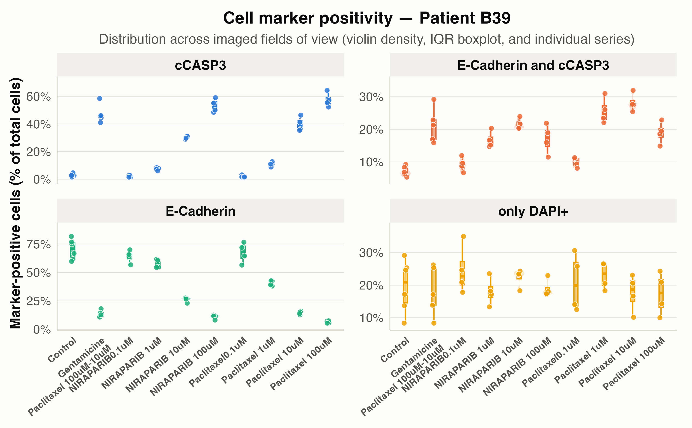
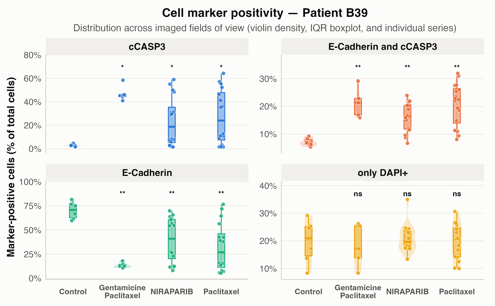
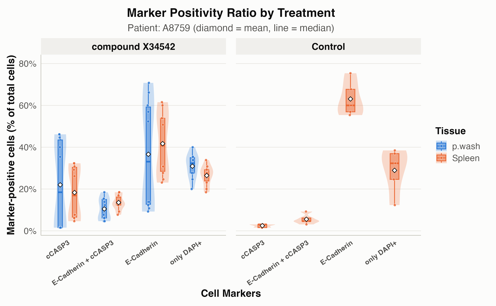
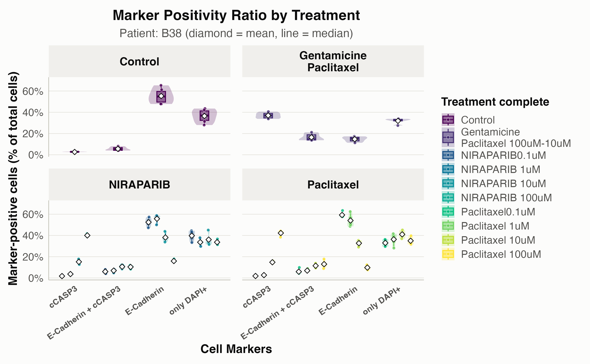

# End-to-End Quality Control and Feature Inspection

## Overview

Before normalizing drug responses or fitting dose-response models, it is
critical to verify that cell segmentation, marker classification, and
replicate fields of view (series) behaved consistently across your
microscopy screen.

This tutorial demonstrates the complete quality control (QC) workflow in
`drugsens`:

1.  Auditing per-image total cell counts (`sum_cells`) and marker ratios
    with
    [`make_count_dataframe()`](https://flalom.github.io/drugsens/reference/make_count_dataframe.md).
2.  Visualizing patient-level marker positivity distributions and
    testing treatments against `Control` with
    [`get_QC_plots()`](https://flalom.github.io/drugsens/reference/get_QC_plots.md).
3.  Comparing marker ratios across tissue origins and drug
    concentrations with
    [`get_QC_plots_parsed_merged_data()`](https://flalom.github.io/drugsens/reference/get_QC_plots_parsed_merged_data.md).
4.  Inspecting single-cell morphological features (such as nuclear area
    and marker intensity) directly from
    [`data_binding()`](https://flalom.github.io/drugsens/reference/data_binding.md).

------------------------------------------------------------------------

## 1. Auditing Image-Level Cell Counts and Marker Ratios

First, bind the example QuPath CSV files and compute image-level counts
using
[`make_count_dataframe()`](https://flalom.github.io/drugsens/reference/make_count_dataframe.md):

\
[`library`](https://rdrr.io/r/base/library.html)`(`[`drugsens`](https://flalom.github.io/drugsens/)`)`\
\
`example_dir`` ``<-`` `[`system.file`](https://rdrr.io/r/base/system.file.html)`(``"extdata/to_merge/"``, package ``=`` ``"drugsens"``)`\
`bind_data`` ``<-`` `[`data_binding`](https://flalom.github.io/drugsens/reference/data_binding.md)`(`\
`  path_to_the_projects_folder ``=`` ``example_dir``,`\
`  files_extension_to_look_for ``=`` ``"csv"`\
`)`\
\
`counts_df`` ``<-`` `[`make_count_dataframe`](https://flalom.github.io/drugsens/reference/make_count_dataframe.md)`(``bind_data``)`\
[`summary`](https://rdrr.io/r/base/summary.html)`(``counts_df``[``, `[`c`](https://rdrr.io/r/base/c.html)`(``"sum_cells"``, ``"cCASP3_ratio_of_total_cells"``,`\
`                      ``"E-Cadherin_ratio_of_total_cells"``, ``"onlyDAPIPositve_ratio_of_total_cells"``)``]``)`\
`#>    sum_cells     cCASP3_ratio_of_total_cells E-Cadherin_ratio_of_total_cells`\
`#>  Min.   :60.00   Min.   :0.0133              Min.   :0.0267                 `\
`#>  1st Qu.:64.00   1st Qu.:0.0290              1st Qu.:0.1500                 `\
`#>  Median :67.00   Median :0.0882              Median :0.4697                 `\
`#>  Mean   :67.46   Mean   :0.1984              Mean   :0.3970                 `\
`#>  3rd Qu.:71.00   3rd Qu.:0.3881              3rd Qu.:0.6000                 `\
`#>  Max.   :75.00   Max.   :0.6429              Max.   :0.8167                 `\
`#>  onlyDAPIPositve_ratio_of_total_cells`\
`#>  Min.   :0.0833                      `\
`#>  1st Qu.:0.2133                      `\
`#>  Median :0.2794                      `\
`#>  Mean   :0.2757                      `\
`#>  3rd Qu.:0.3333                      `\
`#>  Max.   :0.4516`

Pivot the wide count table into tidy long format with
[`change_data_format_to_longer()`](https://flalom.github.io/drugsens/reference/change_data_format_to_longer.md):

\
`long_df`` ``<-`` `[`change_data_format_to_longer`](https://flalom.github.io/drugsens/reference/change_data_format_to_longer.md)`(``counts_df``)`\
[`head`](https://rdrr.io/r/utils/head.html)`(``long_df``[``, `[`c`](https://rdrr.io/r/base/c.html)`(``"PID"``, ``"Tissue"``, ``"Treatment_complete"``, ``"Image_number"``,`\
`                 ``"marker_positivity"``, ``"marker_positivity_ratio"``)``]``)`\
`#> ``# A tibble: 6 × 6`\
`#>   PID   Tissue Treatment_complete Image_number marker_positivity                `\
`#>   ``<chr>`` ``<chr>``  ``<chr>``              ``<chr>``        ``<chr>``                            `\
`#> ``1`` A8759 p.wash compoundX3454210uM series 16    onlyDAPIPositve_ratio_of_total_c…`\
`#> ``2`` A8759 p.wash compoundX3454210uM series 16    E-Cadherin_ratio_of_total_cells  `\
`#> ``3`` A8759 p.wash compoundX3454210uM series 16    cCASP3_ratio_of_total_cells      `\
`#> ``4`` A8759 p.wash compoundX3454210uM series 16    E-Cadherin and cCASP3_ratio_of_t…`\
`#> ``5`` A8759 p.wash compoundX3454210uM series 17    onlyDAPIPositve_ratio_of_total_c…`\
`#> ``6`` A8759 p.wash compoundX3454210uM series 17    E-Cadherin_ratio_of_total_cells  `\
`#> ``# ℹ 1 more variable: marker_positivity_ratio <dbl>`

------------------------------------------------------------------------

## 2. Patient-Level QC Plots (`get_QC_plots()`)

[`get_QC_plots()`](https://flalom.github.io/drugsens/reference/get_QC_plots.md)
displays a trimmed violin density, compact IQR boxplot, and individual
field-of-view points for each cell marker, with independent percentage
y-axes (`scales = "free_y"`) so low-abundance markers like `cCASP3` are
never compressed by high-abundance markers like `E-Cadherin`:

\
[`get_QC_plots`](https://flalom.github.io/drugsens/reference/get_QC_plots.md)`(`\
`  ``long_df``,`\
`  isolate_a_specific_patient ``=`` ``"B39"``,`\
`  save_plots ``=`` ``FALSE`\
`)`

### Comparing Multiple Doses or Treatments with Statistical Annotations

When a patient has multiple treatments or doses (including a `Control`
group), set `compare_to_control = TRUE` to automatically run a Wilcoxon
rank-sum test (`stat_method = "wilcox"`) or t-test
(`stat_method = "t.test"`) against `Control` within each marker facet:

\
[`get_QC_plots`](https://flalom.github.io/drugsens/reference/get_QC_plots.md)`(`\
`  ``long_df``,`\
`  isolate_a_specific_patient ``=`` ``"B39"``,`\
`  x_plot_var ``=`` ``"Treatment"``,`\
`  compare_to_control ``=`` ``TRUE``,`\
`  control_treatment_name ``=`` ``"Control"``,`\
`  stat_method ``=`` ``"wilcox"``,`\
`  p_adjust_method ``=`` ``"BH"``,`\
`  pvalue_label ``=`` ``"p.adj.signif"``,`\
`  save_plots ``=`` ``FALSE`\
`)`

------------------------------------------------------------------------

## 3. Multi-Condition & Dose QC (`get_QC_plots_parsed_merged_data()`)

[`get_QC_plots_parsed_merged_data()`](https://flalom.github.io/drugsens/reference/get_QC_plots_parsed_merged_data.md)
facets by `Treatment` and places all four cell markers side-by-side on
the x-axis, with diamonds marking the group mean and horizontal lines
marking the median.

### Coloring by Tissue Origin (`fill_color_variable = "Tissue"`)

\
`plots_by_tissue`` ``<-`` `[`get_QC_plots_parsed_merged_data`](https://flalom.github.io/drugsens/reference/get_QC_plots_parsed_merged_data.md)`(`\
`  ``long_df``,`\
`  list_of_columns_to_plot ``=`` ``"marker_positivity_ratio"``,`\
`  fill_color_variable ``=`` ``"Tissue"``,`\
`  isolate_specific_patient ``=`` ``"A8759"``,`\
`  save_plots ``=`` ``FALSE``,`\
`  verbose ``=`` ``FALSE`\
`)`\
\
`plots_by_tissue``[[``"A8759.marker_positivity_ratio"``]``]`

### Coloring by Complete Treatment & Dose (`fill_color_variable = "Treatment_complete"`)

When a drug is tested at multiple concentrations (such as `Paclitaxel`
and `NIRAPARIB` from `0.1` to `100` uM), setting
`fill_color_variable = "Treatment_complete"` splits the violins by dose
within each drug facet:

\
`plots_by_dose`` ``<-`` `[`get_QC_plots_parsed_merged_data`](https://flalom.github.io/drugsens/reference/get_QC_plots_parsed_merged_data.md)`(`\
`  ``long_df``,`\
`  list_of_columns_to_plot ``=`` ``"marker_positivity_ratio"``,`\
`  fill_color_variable ``=`` ``"Treatment_complete"``,`\
`  isolate_specific_patient ``=`` ``"B38"``,`\
`  save_plots ``=`` ``FALSE``,`\
`  verbose ``=`` ``FALSE`\
`)`\
\
`plots_by_dose``[[``"B38.marker_positivity_ratio"``]``]`

